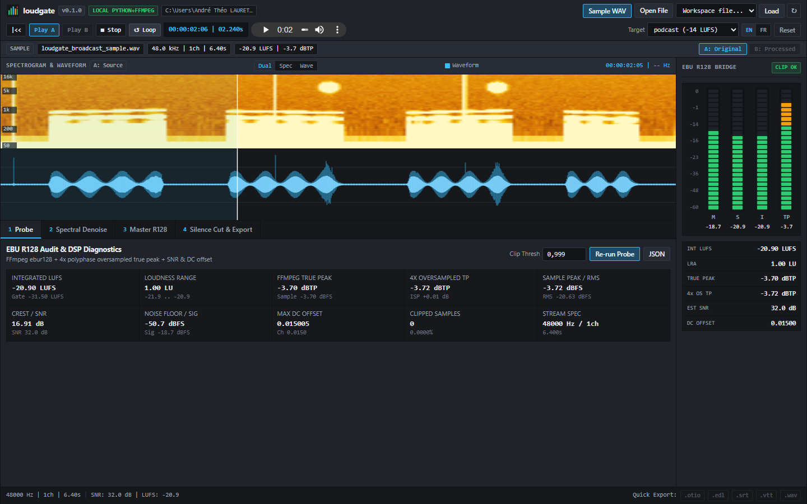

# loudgate

Open-source, clean-room broadcast audio post-production engine in Python + FFmpeg, featuring a local loopback **Studio GUI (`loudgate ui`)**, deterministic CLI, Python API, and `stdio` MCP server.

Everything runs locally on CPU with zero cloud uploads, zero model weight downloads, and zero subscription paywalls.

Live browser demo: [https://eclipse-technology.eu/demos/loudgate/](https://eclipse-technology.eu/demos/loudgate/)



## Documentation

- **English**: [Overview](docs/index.md) | [Studio GUI Guide](docs/gui-guide.md) | [CLI & Python Reference](docs/cli-reference.md) | [MCP Setup](docs/mcp-setup.md)
- **Francais**: [Presentation](docs/fr/index.md) | [Guide Interface Studio](docs/fr/gui-guide.md) | [Reference CLI & Python](docs/fr/cli-reference.md) | [Configuration MCP](docs/fr/mcp-setup.md)

## Why loudgate

| Workflow | Proprietary paywalls | loudgate (MIT) |
| :--- | :--- | :--- |
| Visual Audio Console & A/B Audition | Desktop GUI suites ($399+) | Local loopback `loudgate ui` / `loudgate-ui` with Canvas waveform & EBU R128 meters |
| Spectral denoise, de-click, HPF | Per-plugin licenses | Deterministic STFT WOLA + zero-phase Butterworth SOS |
| Loudness audit & mastering | Monthly NLE add-ons ($22.99/mo) | Two-pass FFmpeg `loudnorm` + 4x oversampled true-peak ceiling |
| Silence removal + NLE cut export | Per-seat podcast editors ($24-$65/mo) | Energy/ZCR VAD + `.otio` / CMX 3600 `.edl` / `.srt` / `.vtt` / WAV |
| Automation & editor integration | Closed plugins | Scriptable CLI, Python API, and `stdio` MCP server |

## Requirements

- Python 3.10+
- `ffmpeg` and `ffprobe` on `PATH`
- Python packages: `numpy`, `scipy`, `soundfile`

## Installation

```bash
git clone https://github.com/eldertek/loudgate.git
cd loudgate
pip install -e ".[dev]"
```

## Quick Start: Studio GUI (`loudgate ui`)

Launch the local mastering & spectral workstation (binds strictly to `127.0.0.1`, default port `8742`):

```bash
loudgate ui
# standalone desktop window mode (pywebview or Edge/Chrome --app):
loudgate ui --desktop
# or standalone entrypoint:
loudgate-ui --desktop
loudgate-ui --workspace-dir ./episodes --no-open
```

Inside the DAW console (`EN` / `FR` language toggle built in, with automatic WebAudio demo fallback when hosted statically at [https://eclipse-technology.eu/demos/loudgate/](https://eclipse-technology.eu/demos/loudgate/)):
1. Click **Sample WAV** (or open/drop any local file or select from `--workspace-dir`).
2. Inspect the **Dual-Layer STFT Spectrogram + Waveform** and **Vertical EBU R128 LED Meter Bridge** (`M`, `S`, `I`, `TP`, `LRA`, `SNR`, `DC offset`, `CLIP` LED).
3. Clean 38 Hz rumble, clicks, hiss, and sibilance in **Spectral Denoise**, audition **Play A vs Play B**, or click **Use as Source**.
4. Normalize in **Master R128** (`podcast -14`, `mobile -16`, `broadcast -23 LUFS`, etc. loaded from `MASTER_PRESETS`).
5. Segment speech vs silence in **Silence Cut & Export** with green Keep / red Trim waveform markers, draggable threshold line, and one-click `.otio`, `.edl`, `.srt`, `.vtt`, and trimmed `.wav` downloads.

## Quick Start (CLI)

### 1. Audit loudness, peaks, clipping, DC offset, and SNR

```bash
loudgate probe episode_raw.wav --json
```

Reports EBU R128 integrated loudness (`LUFS`), loudness range (`LRA`), FFmpeg true peak (`dBTP`), 4x polyphase oversampled inter-sample peak excess, DC offset per channel, clipped sample ratio, and estimated SNR (`dB`).

### 2. Clean noise, rumble, and clicks

```bash
loudgate clean episode_raw.wav episode_clean.wav --highpass-hz 80 --denoise-strength 1.0 --deess
```

Pipeline stages:
- DC offset removal
- Zero-phase 4th-order Butterworth high-pass filter (`scipy.signal.sosfiltfilt`, zero group-delay distortion)
- MAD second-difference de-clicker for isolated digital impulses
- Tight-frame periodic root-Hann STFT WOLA spectral Wiener denoising (`n_fft=2048`, `hop_length=512`)
- Optional split-band sibilance attenuator (`--deess`) and downward noise gate (`--gate`)

### 3. Master to broadcast or podcast targets

```bash
# Podcast / Web (-14 LUFS, <= -1.0 dBTP)
loudgate master episode_clean.wav episode_podcast.wav --preset podcast

# EBU R128 Broadcast (-23 LUFS, <= -1.0 dBTP)
loudgate master episode_clean.wav episode_broadcast.wav --preset broadcast

# Mobile / Stereo (-16 LUFS, <= -1.0 dBTP) + MP3 export
loudgate master episode_clean.wav episode_mobile.mp3 --preset mobile --bitrate 192k
```

Uses two-pass linear FFmpeg `loudnorm` followed by a post-render `ebur128` verification pass and a 4x oversampled PCM true-peak safety limiter when needed.

### 4. Cut silences and export NLE timelines + subtitles

```bash
loudgate cut episode_podcast.wav ./cuts/ --thresh-db -40 --min-silence-ms 400 --pad-ms 80 --fps 25
```

Outputs into `./cuts/`:
- `episode_podcast.otio` (OpenTimelineIO JSON timeline for DaVinci Resolve / Premiere workflows)
- `episode_podcast.edl` (CMX 3600 EDL)
- `episode_podcast.srt` and `episode_podcast.vtt` (cue timestamps aligned to the trimmed timeline)
- `episode_podcast_cut.wav` (rendered via FFmpeg `atrim` + micro-fades + `concat`)

### 5. Run as an MCP `stdio` server

```bash
loudgate mcp
```

Exposed MCP tools:
- `probe_loudness`
- `clean_spectral`
- `master_broadcast`
- `cut_silences_otio`

Example MCP client configuration:

```json
{
  "mcpServers": {
    "loudgate": {
      "command": "loudgate",
      "args": ["mcp"]
    }
  }
}
```

## Python API

```python
from loudgate import CleanConfig, MasterConfig, clean_file, cut_silences, master_file, probe_file

report = probe_file("raw.wav")
clean_file("raw.wav", "clean.wav", CleanConfig(highpass_hz=80.0, denoise_strength=1.0))
master = master_file("clean.wav", "master.wav", MasterConfig(preset="podcast"))
cuts = cut_silences("master.wav", "exports/")
```

## v0.1 Scope and Known Limitations

- The STFT Wiener denoiser targets stationary background noise (room floor, fan hiss, hum) rather than heavy room dereverberation or overlapping-speaker separation.
- Silence cutting uses RMS energy + zero-crossing rate VAD; it does not perform ASR transcription or speaker diarization.
- Mastering and container transcoding rely on a local `ffmpeg` / `ffprobe` binary installed on `PATH`.

## Running Tests

```bash
pytest -v
```

The test suite verifies DSP invariants and UI integration:
- Parseval energy conservation across the tight-frame STFT/ISTFT (`relative error < 1e-12`)
- Zero-phase high-pass attenuation and impulse click repair
- Real FFmpeg `ebur128` verification before and after two-pass `loudnorm` at `-14`, `-16`, and `-23 LUFS` with `true_peak_dbtp <= -1.0`
- VAD/silence segmentation, valid OTIO/EDL/SRT/VTT generation, and FFmpeg `atrim` rendering
- MCP JSON-RPC 2.0 `stdio` protocol round-trips
- Studio UI loopback HTTP endpoints, CSP & path traversal rejections, byte-range streaming, and full DSP round-trips

## Commercial Support & Custom Pipelines

Need custom audio post-production automation, broadcast QA integration, or dedicated maintenance? See [Eclipse Technology Open Source Pro](https://eclipse-technology.eu/open-source-pro.html).

## License

MIT License. See [LICENSE](LICENSE).
