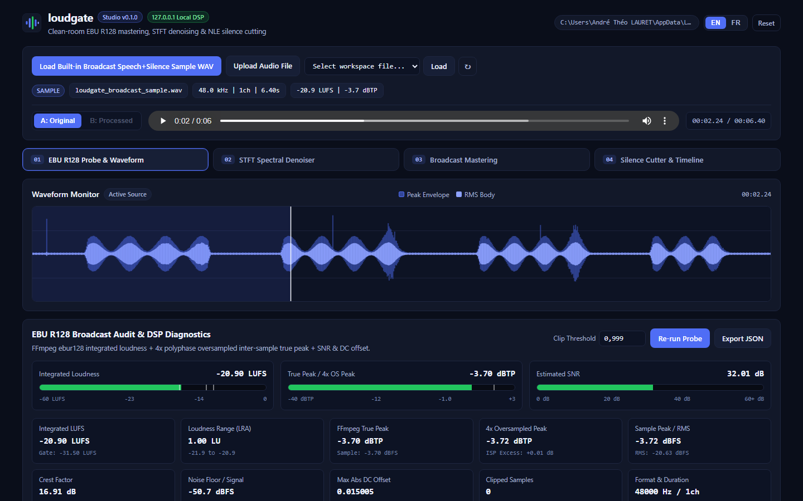
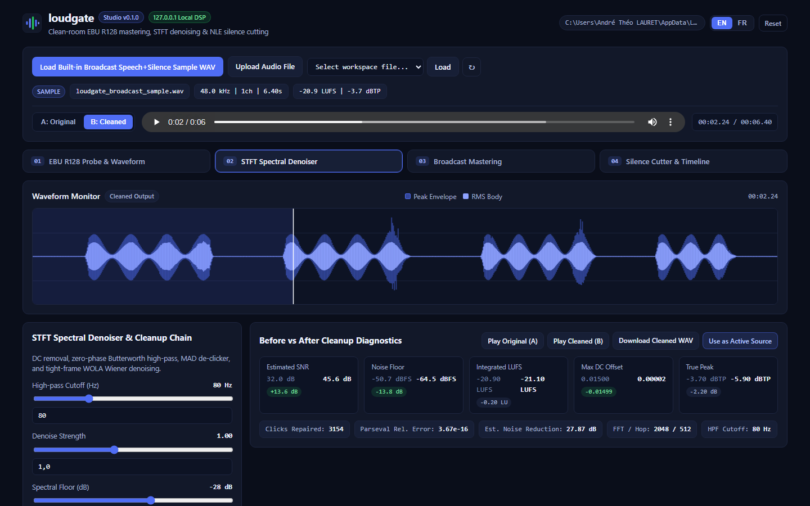
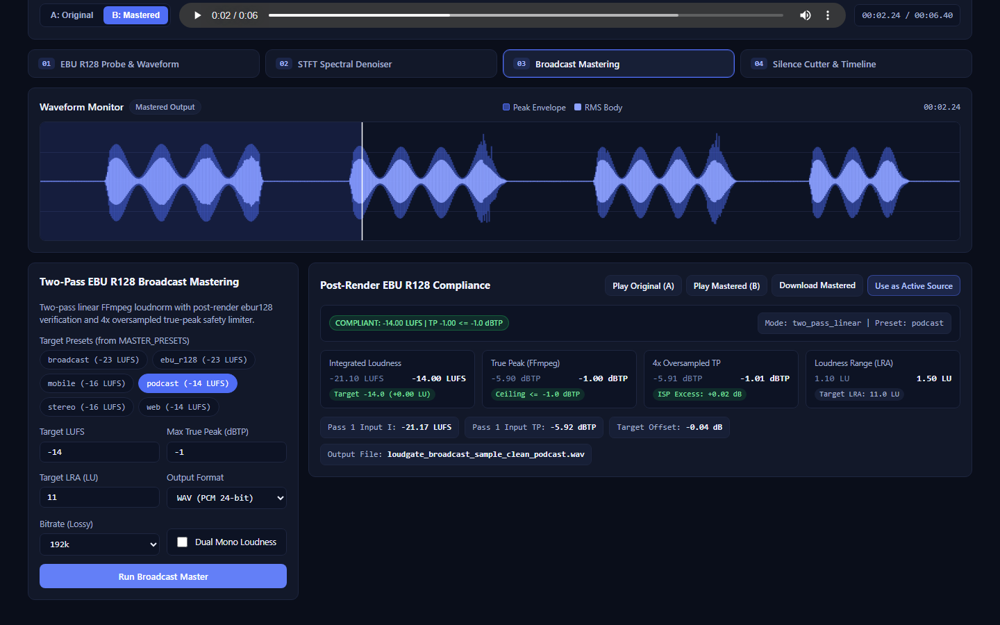
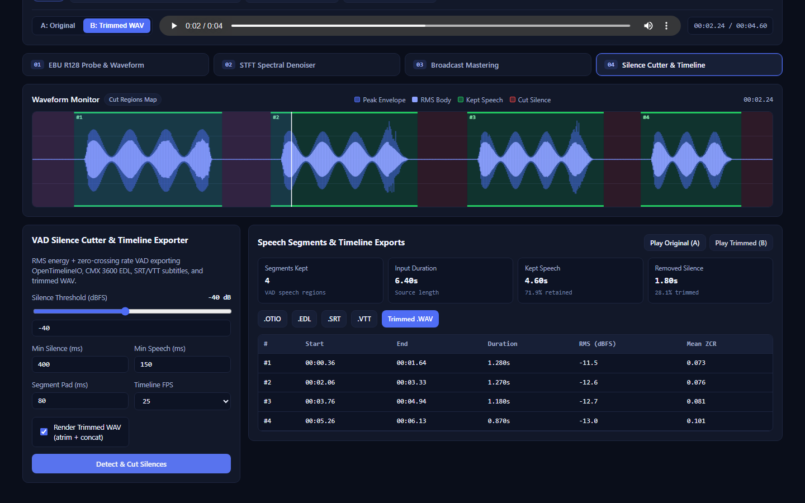
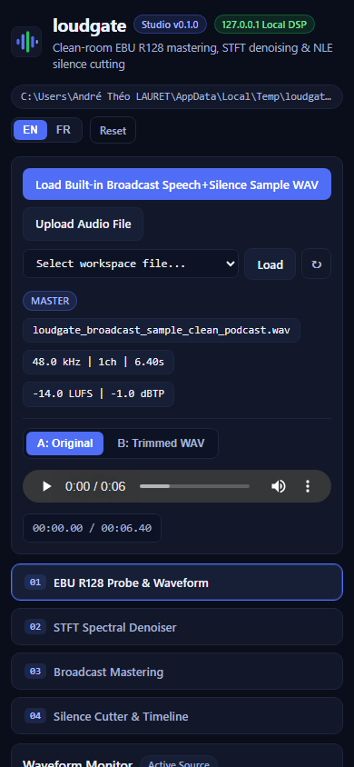

# Guide de l'interface Studio (`loudgate ui`)

[English Guide (EN)](../gui-guide.md) | [Index Documentation](index.md)

`loudgate ui` (egalement disponible via la commande autonome `loudgate-ui`) demarre une console web locale d'ingenierie audio connectee directement aux algorithmes DSP Python (`probe_file`, `clean_file`, `master_file`, `cut_silences`).



## Lancement du Studio

```bash
# Lancement par defaut sur http://127.0.0.1:8742/ avec ouverture du navigateur
loudgate ui

# Commande dediee pointant vers un dossier local sans ouvrir d'onglet navigateur
loudgate-ui --workspace-dir ./episodes --port 8742 --no-open

# Port ephemere choisi par le systeme
loudgate ui --port 0
```

### Options CLI

| Option | Defaut | Description |
| :--- | :--- | :--- |
| `--host` | `127.0.0.1` | Adresse loopback (`127.0.0.1`, `localhost`, `::1`). Toute adresse non loopback est refusee pour la securite locale. |
| `--port` | `8742` | Port TCP local (`0` attribue automatiquement un port libre). |
| `--workspace-dir` | `.` | Repertoire racine confine par `realpath` pour la selection de fichiers audio du workspace. |
| `--no-open` | `false` | Ne pas ouvrir automatiquement le navigateur au demarrage. |

## Modele de securite et confidentialite

- **Ecoute loopback uniquement** : Refuse `0.0.0.0` ou les IP reseau afin que vos fichiers audio restent strictement locaux.
- **Confinement du workspace** : La selection de fichiers locaux est verrouillee dans `--workspace-dir` via `os.path.realpath`. Toute tentative de traversee (`..`) est rejetee en HTTP `403`.
- **Validation des imports** : Les fichiers televerses (jusqu'a 100 Mio) subissent un filtrage d'extension, une verification des octets magiques (header audio) et un decodage SoundFile/FFmpeg dans un dossier temporaire hors racine web.
- **CSP stricte** : En-tetes `default-src 'self'; script-src 'self'; style-src 'self'` et zero `innerHTML` ou `eval`.

## Chargement audio & Ecoute comparative A/B

La barre superieure **Source & Transport** propose trois methodes de chargement :

1. **Charger l'echantillon Parole+Silence integre (WAV)** : Genere une piste deterministe de 6,4 s a 48 kHz contenant quatre phrases vocales separees par des pauses, du grondement 38 Hz, du souffle, un offset DC (`+0.015`), des sibilances et 3 clics impulsionnels pour tester immediatement tous les modules.
2. **Importer un fichier audio / Glisser-deposer** : Selectionnez ou deposez un fichier `.wav`, `.flac`, `.ogg`, `.aiff`, `.mp3`, `.m4a`, `.aac` ou `.opus`.
3. **Selecteur de fichiers du workspace** : Choisissez un fichier audio detecte dans `--workspace-dir`.

Utilisez le commutateur **A : Original** / **B : Traite** et le lecteur HTML5 (avec recherche par plages d'octets `Range`) pour comparer l'avant et l'apres, ou cliquez/glissez directement sur le **Moniteur Forme d'onde**. Le bouton **EN | FR** en haut a droite bascule instantanement toute l'interface.

## Onglet 1 : Sonde EBU R128 & Forme d'onde

Analyse le fichier actif via `probe_file` :

- **Rack de vu-metres EBU R128** : Barres vert/ambre/rouge pour le Loudness Integre (`LUFS` avec reperes `-23`, `-16`, `-14`), la Crete Vraie / Crete 4x (`dBTP` avec seuil `-1.0`) et le RSB estime (`dB`).
- **Grille de diagnostics** : `LRA` (`LU`), seuil de gate, crete echantillon FFmpeg, crete vraie surechantillonnee 4x et exces inter-echantillons, RMS, facteur de crete, plancher de bruit, offset DC max et nombre d'echantillons satures.
- **Actions** : Regler `Seuil Clipping` (`0.999` par defaut), relancer la sonde ou exporter le rapport JSON.

## Onglet 2 : Debruiteur Spectral STFT (`clean`)



Execute `clean_file` avec controles interactifs relies directement a `CleanConfig` :

- **Coupure Passe-Haut (Hz)** (`0` a `2000 Hz`, defaut `80 Hz`) : Filtre Butterworth d'ordre 4 a phase nulle (`sosfiltfilt`) supprimant les grondements graves sans distorsion de phase.
- **Intensite Debruitage** (`0.0` a `5.0`, defaut `1.0`) et **Plancher Spectral (dB)** (`-90` a `0 dB`, defaut `-28 dB`) : Filtre de Wiener STFT WOLA a trame serree.
- **Taille FFT / Pas (Hop)** : Choix de fenetres compatibles COLA (`512`, `1024`, `2048`, `4096`) et pas en echantillons (ex. `512`). Un ratio non valide affiche une erreur de validation explicite.
- **Options** : `De-clicker (MAD)`, `Supprimer Offset DC`, `De-esseur bande haute` et `Noise Gate progressif`.

Apres traitement, comparez les deltas Avant/Apres (`RSB`, `Plancher de bruit`, `LUFS`, `Offset DC`, `Crete Vraie`), verifiez `Parseval Rel. Error` (`< 1e-12`), ecoutez A vs B, telechargez le `.wav` nettoye ou cliquez sur **Utiliser comme source active** pour enchainer avec le mastering.

## Onglet 3 : Mastering Broadcast (`master`)



Les presets cibles sont lus dynamiquement depuis `MASTER_PRESETS` cote Python :

- `podcast` / `web` : `-14.0 LUFS`, `<= -1.0 dBTP`, `LRA 11.0 LU`
- `mobile` / `stereo` : `-16.0 LUFS`, `<= -1.0 dBTP`, `LRA 9.0 LU`
- `broadcast` / `ebu_r128` : `-23.0 LUFS`, `<= -1.0 dBTP`, `LRA 7.0 LU`

Vous pouvez personnaliser la cible LUFS, la Crete Vraie Max (`dBTP`), le LRA cible (`LU`), le format de sortie (`wav`, `flac`, `mp3`, `m4a`), le debit (`128k` a `320k`) et le mode Dual Mono. Les resultats post-rendu confirment la conformite, permettent l'ecoute A/B et le telechargement, ainsi que le chainage vers l'onglet de decoupe.

## Onglet 4 : Decoupe Silences & Timeline (`cut`)



Execute `cut_silences` (energie `RMS` + `ZCR`) :

- Reglez **Seuil Silence (dBFS)** (`-40 dB` par defaut), **Silence Min (ms)** (`400 ms`), **Parole Min (ms)** (`150 ms`), **Marge bords (ms)** (`80 ms`), **Cadence FPS** (`23.976` a `60`) et **Generer WAV decoupe**.
- Le **Moniteur Forme d'onde** surligne les zones **Parole conservee** en vert, les zones **Silence coupe** en rouge et le seuil par des lignes pointillees orange.
- Cliquez sur une ligne du tableau des segments pour placer la lecture audio directement au debut du segment.
- Telechargez en un clic les exports `.otio` (OpenTimelineIO), `.edl` (CMX 3600), `.srt` (SubRip), `.vtt` (WebVTT) et `_cut.wav`.

## Affichage mobile et ecrans etroits

L'interface s'adapte proprement jusqu'a `375px` de large avec panneaux empiles, redimensionnement automatique du canvas, tableaux defilants horizontalement et zero debordement de page :


