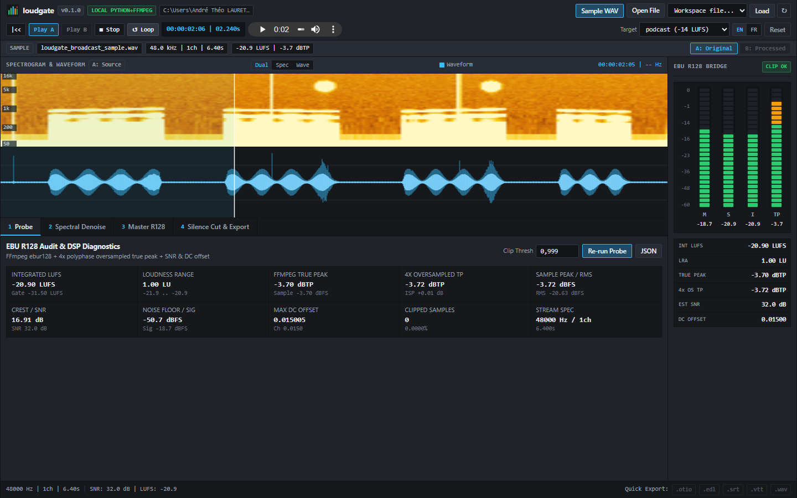
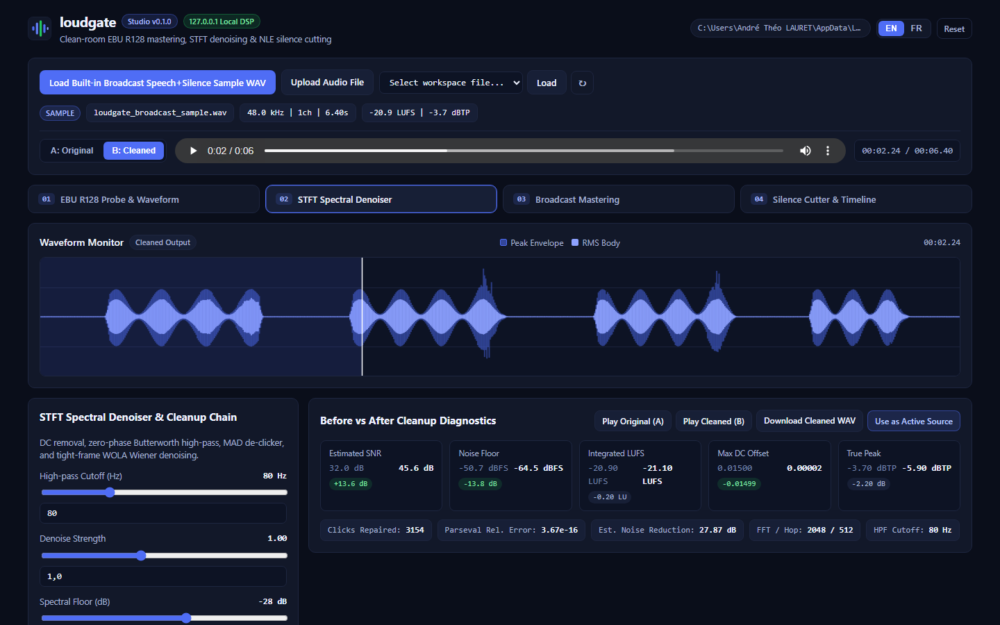
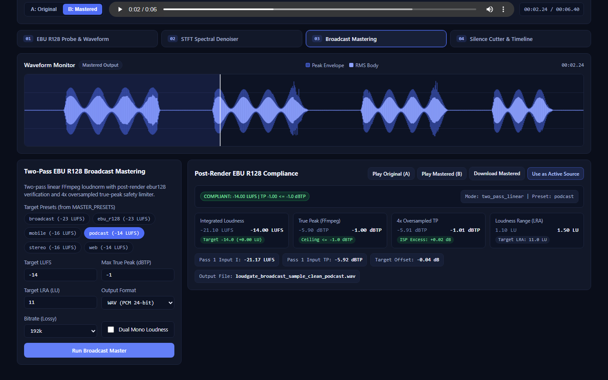
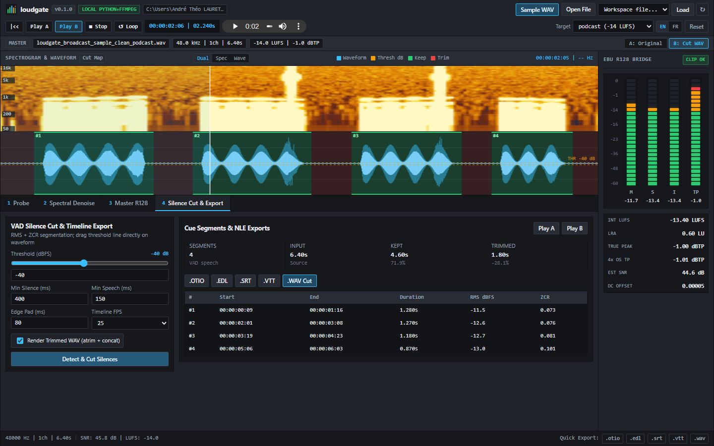
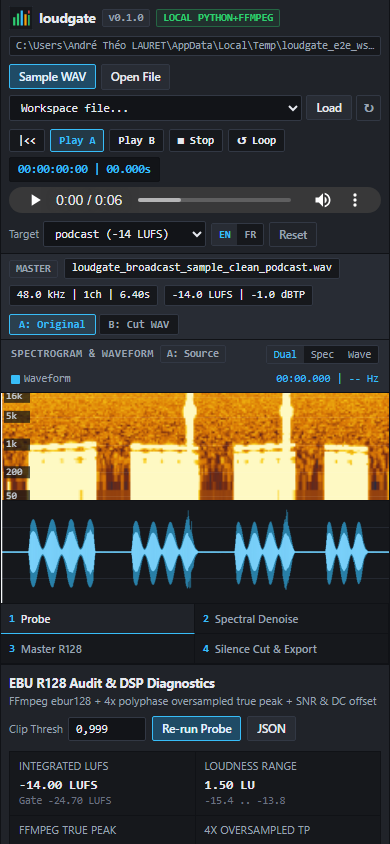

# Local Studio GUI Guide (`loudgate ui`)

[Guide Francais (FR)](fr/gui-guide.md) | [Documentation Index](index.md)

`loudgate ui` (also available via the standalone `loudgate-ui` command) starts a local loopback web audio engineering console powered directly by the Python DSP engine (`probe_file`, `clean_file`, `master_file`, `cut_silences`).



# Launching the Studio

```bash
# Default launch on http://127.0.0.1:8742/ and open default browser
loudgate ui

# Standalone desktop app window mode (pywebview or Edge/Chrome --app without browser tabs)
loudgate ui --desktop

# Standalone entrypoint pointing at a specific media folder without auto-opening browser
loudgate-ui --workspace-dir ./episodes --port 8742 --no-open

# Ephemeral OS-chosen port
loudgate ui --port 0
```

### CLI Options

| Flag | Default | Description |
| :--- | :--- | :--- |
| `--host` | `127.0.0.1` | Loopback IPv4/IPv6 host (`127.0.0.1`, `localhost`, `::1`). Non-loopback hosts are rejected for local security. |
| `--port` | `8742` | Local TCP port (`0` assigns an available ephemeral port automatically). |
| `--workspace-dir` | `.` | Root directory safely exposed to the Workspace File selector via `realpath` confinement. |
| `--no-open` | `false` | Do not open a browser tab automatically on startup. |
| `--desktop` | `false` | Launch in a standalone desktop application window (`pywebview` if installed, or Chromium/Edge `--app` fallback). |

## Workstation Layout & Modes

- **Top Transport & File Ribbon**: Load `Sample WAV`, `Open File`, or Workspace audio; control DAW transport (`Rewind`, `Play A`, `Play B`, `Stop`, `Loop`) with SMPTE timecode readout and quick Target Preset selection.
- **Central Dual-Layer Spectrogram & Waveform Bay**: Displays log-frequency STFT spectrogram (`40 Hz - 20 kHz`) over cyan peak/RMS waveform (`Dual`, `Spec`, or `Wave` views). Click to seek or drag the amber `THR` threshold line directly on the waveform in Tab 4.
- **Right Docked Vertical EBU R128 Meter Bridge**: Live segmented LED columns for Momentary (`M`), Short-Term (`S`), Integrated (`I`), and True Peak (`TP`) with `-60` to `0 dB` scale, `CLIP OK` / `CLIP OVER` latching indicator, and numeric LRA/SNR/DC readouts.
- **Bottom DAW Status Bar**: Shows sample rate, channels, duration, SNR delta, and one-click `.otio`, `.edl`, `.srt`, `.vtt`, and `.wav` export buttons.
- **Static Browser Demo Mode**: When static assets (`src/loudgate/ui/static/`) are served directly without a local Python backend (such as [https://eclipse-technology.eu/demos/loudgate/](https://eclipse-technology.eu/demos/loudgate/)), the UI automatically activates a pure WebAudio/JavaScript DSP engine (`BROWSER WEBAUDIO DEMO`).

## Security & Privacy Model

- **Loopback-only binding**: Refuses non-loopback addresses (`0.0.0.0`, LAN IPs) so audio files stay strictly on your machine.
- **Workspace confinement**: Local file selection is confined inside `--workspace-dir` using canonical `os.path.realpath` checks. Path traversal (`..`) and escapes are rejected with HTTP `403`.
- **Validated uploads**: Uploaded audio files (up to 100 MiB) undergo extension allowlisting, file header magic-byte verification, and FFmpeg/soundfile decode checks inside an ephemeral session directory outside webroot.
- **Strict browser CSP**: Served with `default-src 'self'; script-src 'self'; style-src 'self'` and zero `innerHTML` or `eval`.

## Loading Audio & A/B Auditioning

The top **Source & Transport Dock** offers three ways to load audio:

1. **Load Built-in Broadcast Speech+Silence Sample WAV**: Generates a deterministic 48 kHz 6.4 s test track containing four speech-like phrases separated by pauses, 38 Hz rumble, room hiss, DC offset (`+0.015`), sibilance, and 3 isolated digital clicks so you can test every DSP module immediately.
2. **Upload Audio File / Drag & Drop**: Select or drag any `.wav`, `.flac`, `.ogg`, `.aiff`, `.mp3`, `.m4a`, `.aac`, or `.opus` file onto the dock.
3. **Workspace File Selector**: Pick any audio file discovered inside `--workspace-dir`.

Use the **A: Original** / **B: Processed** switcher and built-in HTML5 transport bar (with byte-range seeking) to compare original vs processed audio in real time, or click/drag directly on the **Waveform Monitor** canvas to scrub. Switch between **EN** and **FR** at any time in the header.

## Tab 1: EBU R128 Probe & Waveform

Inspects incoming audio using `probe_file`:

- **EBU R128 Broadcast Meter Rack**: Color-coded green/amber/red meters for Integrated Loudness (`LUFS` with `-23`, `-16`, `-14` ticks), True Peak / 4x Oversampled Peak (`dBTP` with `-1.0` ceiling marker), and Estimated SNR (`dB`).
- **Diagnostic Grid**: LRA (`LU`), Gate Threshold, FFmpeg Sample Peak, 4x Oversampled True Peak and Inter-Sample Peak Excess, RMS, Crest Factor, Noise Floor, Max Abs DC Offset, and Clipped Sample count.
- **Actions**: Adjust `Clip Threshold` (`0.999` default), re-run probe, or export the complete JSON report.

## Tab 2: STFT Spectral Denoiser (`clean`)



Runs `clean_file` with interactive controls mapped directly to `CleanConfig`:

- **High-pass Cutoff (Hz)** (`0` to `2000 Hz`, default `80 Hz`): Zero-phase 4th-order Butterworth HPF (`sosfiltfilt`) to strip sub-bass rumble and plosive thumps without phase distortion.
- **Denoise Strength** (`0.0` to `5.0`, default `1.0`) and **Spectral Floor (dB)** (`-90` to `0 dB`, default `-28 dB`): Tight-frame periodic root-Hann STFT WOLA Wiener filter.
- **FFT Size / Hop Length**: Choose COLA-compatible FFT sizes (`512`, `1024`, `2048`, `4096`) and hop length (e.g. `512`). Invalid non-COLA ratios display an inline validation error.
- **Pipeline Toggles**: `De-clicker (MAD)`, `Remove DC Offset`, `Split-band De-esser`, and `Downward Noise Gate`.

After processing, inspect Before/After delta cards (`SNR`, `Noise Floor`, `Integrated LUFS`, `Max DC Offset`, `True Peak`), verify `Parseval Rel. Error` (`< 1e-12`), audition A vs B, download the cleaned `.wav`, or click **Use as Active Source** to chain straight into Mastering.

## Tab 3: Broadcast Mastering (`master`)



Preset pills are populated dynamically from Python's `MASTER_PRESETS`:

- `podcast` / `web`: `-14.0 LUFS`, `<= -1.0 dBTP`, `LRA 11.0 LU`
- `mobile` / `stereo`: `-16.0 LUFS`, `<= -1.0 dBTP`, `LRA 9.0 LU`
- `broadcast` / `ebu_r128`: `-23.0 LUFS`, `<= -1.0 dBTP`, `LRA 7.0 LU`

You can override Target LUFS, Max True Peak (`dBTP`), Target LRA (`LU`), Output Format (`wav`, `flac`, `mp3`, `m4a`), Lossy Bitrate (`128k` to `320k`), and Dual Mono mode. Post-render results verify compliance against the target ceiling, show Pass 1 measurement statistics, allow A/B auditioning and download, and support **Use as Active Source** for chaining into Silence Cutting.

## Tab 4: Silence Cutter & Timeline (`cut`)



Runs `cut_silences` (`RMS` energy + `ZCR` hysteresis):

- Configure **Silence Threshold (dBFS)** (`-40 dB` default), **Min Silence (ms)** (`400 ms`), **Min Speech (ms)** (`150 ms`), **Segment Pad (ms)** (`80 ms`), **Timeline FPS** (`23.976` to `60`), and **Render Trimmed WAV**.
- The **Waveform Monitor** overlays **Kept Speech** regions in green, **Cut Silence** gaps in red, and orange dashed threshold lines.
- Click any row in the **Segments Table** to seek the audio player straight to that segment's start timestamp.
- Download ready-to-import `.otio` (OpenTimelineIO), `.edl` (CMX 3600), `.srt` (SubRip), `.vtt` (WebVTT), and trimmed `_cut.wav` files with one click.

## Mobile & Narrow Viewport Support

The interface adapts cleanly down to `375px` mobile screens with stacked controls, responsive canvas resizing, horizontally scrollable segment tables, and zero page overflow:


